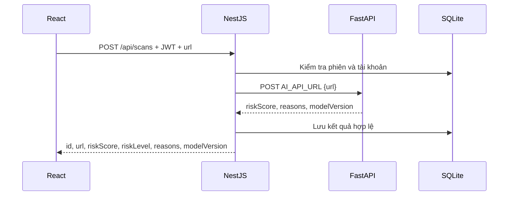

# Backend NestJS — Hệ thống phát hiện website Phishing bằng AI

Backend cho Người 2: NestJS 11, TypeScript, Prisma 6.19 và SQLite. Đã có xác thực, JWT có thể thu hồi, phân quyền User/Admin, tích hợp FastAPI, lịch sử, báo cáo, quản trị, Swagger, Postman, migration, kiểm thử và Docker.

Mô hình AI do thành viên AI cung cấp. Backend không trả điểm giả nếu dịch vụ AI chưa có. Fixture FastAPI trong thư mục `integration` chỉ dùng kiểm thử hợp đồng, không phải mô hình phát hiện phishing.

## 1. Chạy từ đầu

Yêu cầu Node.js 22 hoặc 24 và npm. Khuyến nghị Node.js 24.

```sh
cd backend
npm ci
npm run setup
npm start
```

Chi tiết cấu hình local/Docker và tích hợp AI: [Hướng dẫn môi trường](docs/CAU_HINH_MOI_TRUONG.md). Có thể tạo riêng bằng `npm run env:init` và kiểm tra sau build bằng `npm run env:check`.

`setup` tự tạo `.env` với JWT secret ngẫu nhiên nếu chưa có, sinh Prisma Client, áp dụng migration và build. Chạy lại giữ nguyên các giá trị cấu hình đang có, bổ sung biến còn thiếu và không xóa database. JWT để trống được sinh tự động nếu chưa được cấp qua biến môi trường của tiến trình. Không cần tự tạo bảng. Trong môi trường cloud với cache mặc định chỉ đọc, dùng `npm ci --cache /tmp/phishing-npm-cache`.

- API mặc định: cổng 3000, tiền tố `/api`.
- Kiểm tra bằng `curl -f http://localhost:3000/api/health` trên máy đang chạy.
- Swagger nằm tại đường dẫn `/api/docs` trên server.
- OpenAPI JSON nằm tại `/api/openapi.json`.
- Phát triển có tự build/restart: `npm run dev`.

`.env` và database bị loại khỏi Git. Không copy đè `.env.example` lên `.env` đã có. Nếu tạo `.env` thủ công, đặt `JWT_SECRET` ít nhất 32 byte; không dùng chuỗi mẫu cố định cho ứng dụng thật.

## 2. Cấu hình

| Biến | Giá trị/mục đích |
|---|---|
| NODE_ENV | development, production hoặc test |
| DATABASE_URL | `file:./dev.db`; đường dẫn tương đối tính từ thư mục `prisma`. Có thể dùng `file:/absolute/path.db`. Chỉ hỗ trợ SQLite local |
| JWT_SECRET | Secret riêng của môi trường, ít nhất 32 byte; thay đổi secret sẽ làm mọi token cũ không còn hợp lệ |
| PORT | Mặc định 3000 |
| FRONTEND_ORIGIN | Mặc định `http://localhost:5173`; một origin, không có đường dẫn hoặc dấu `/` cuối |
| HTTP_RATE_LIMIT | Mặc định 120 yêu cầu/phút/IP/endpoint |
| AI_API_URL | Endpoint FastAPI đầy đủ, ví dụ `http://127.0.0.1:8000/predict` |
| AI_TIMEOUT_MS | Mặc định 10000, cho phép 100–60000 ms |
| AI_API_TOKEN | Bearer token gọi FastAPI nếu dịch vụ AI yêu cầu; tùy chọn |

`aiConfigured` trong health chỉ thể hiện có endpoint được cấu hình. Không khẳng định mô hình đang hoạt động. Nếu chưa có AI, vẫn dùng được đăng ký/đăng nhập, quản lý báo cáo và quản trị; `/api/scans` trả 503.

## 3. API và quyền truy cập

API ngoài health, đăng ký và đăng nhập cần header `Authorization: Bearer <accessToken>`. ADMIN có thể dùng cả API User và API Admin. Các API User chỉ thao tác dữ liệu thuộc tài khoản đang đăng nhập.

| Method | Endpoint | Chức năng |
|---|---|---|
| GET | /api/health | Kiểm tra database |
| POST | /api/auth/register | Đăng ký USER |
| POST | /api/auth/login | Đăng nhập, tạo phiên JWT 1 giờ |
| POST | /api/auth/logout | Thu hồi phiên hiện tại |
| GET | /api/auth/me | Thông tin tài khoản |
| PATCH | /api/auth/me | Cập nhật tên |
| PATCH | /api/auth/password | Đổi mật khẩu, thu hồi mọi phiên |
| POST | /api/scans | Gọi AI, lưu kết quả thành công |
| GET | /api/scans | Lịch sử cá nhân |
| GET | /api/scans/:id | Chi tiết lịch sử cá nhân |
| DELETE | /api/scans/:id | Xóa một bản ghi của mình |
| POST | /api/reports | Gửi báo cáo website |
| GET | /api/reports | Danh sách báo cáo cá nhân |
| GET | /api/reports/:id | Chi tiết báo cáo cá nhân |
| GET | /api/admin/users | ADMIN: danh sách người dùng |
| PATCH | /api/admin/users/:id/block | ADMIN: khóa/mở khóa tài khoản |
| GET | /api/admin/reports | ADMIN: tất cả báo cáo |
| PATCH | /api/admin/reports/:id | ADMIN: trạng thái và ghi chú xử lý |
| GET | /api/admin/scans | ADMIN: tất cả lịch sử |
| GET | /api/admin/stats | ADMIN: thống kê |
| GET | /api/admin/ai/status | ADMIN: các phiên bản mô hình đã trả kết quả |

Ví dụ đăng ký:

```json
{"email":"user@example.com","name":"Nguyễn Văn An","password":"YourOwnPassword123"}
```

Đăng nhập chỉ gửi `email` và `password`. Response xác thực có `user`, `accessToken`, `expiresIn: 3600`; không có passwordHash. Không cần gửi userId khi tạo scan/báo cáo vì backend lấy từ phiên đăng nhập.

Các danh sách nhận `?page=1&pageSize=20`, pageSize tối đa 100:

```json
{"items":[],"total":0,"page":1,"pageSize":20,"totalPages":0}
```

Lỗi có `statusCode`, `message`, `path`, `requestId`, `timestamp`. `message` có thể là chuỗi hoặc mảng lỗi validation. Response header `X-Request-Id` phục vụ đối chiếu lỗi.

- 400: dữ liệu sai, field lạ hoặc URL không hỗ trợ.
- 401: sai thông tin đăng nhập, token hết hạn/thu hồi hoặc tài khoản bị khóa.
- 403: cần quyền ADMIN.
- 404: bản ghi không tồn tại hoặc không thuộc tài khoản.
- 409: email đã tồn tại.
- 413: JSON body quá 16 KiB.
- 429: quá giới hạn tần suất; xem `Retry-After`.
- 503: AI chưa cấu hình, lỗi HTTP, timeout hoặc sai hợp đồng dữ liệu.

## 4. Cấp quyền Admin

Đăng ký một tài khoản thường trước, sau đó người vận hành có quyền truy cập database chạy:

```sh
npm run admin:promote -- admin@example.com
```

Không có API tự cấp ADMIN và không tạo tài khoản/mật khẩu mặc định. Đăng nhập tài khoản đó để dùng API Admin. Khóa tài khoản thu hồi toàn bộ phiên ngay; mở khóa cần đăng nhập lại. Admin không được tự khóa mình.

Đổi mật khẩu gửi `{ "currentPassword": "...", "newPassword": "..." }`. Sau thành công, tất cả phiên của tài khoản bị thu hồi. Logout chỉ thu hồi phiên hiện tại. Mật khẩu mới ít nhất 12 ký tự, có chữ hoa, chữ thường và số. Mật khẩu dùng bcrypt cost 12, tối đa 72 byte UTF-8. Chưa có refresh token, xác minh email hoặc quên mật khẩu.

## 5. Hợp đồng với FastAPI



Request tới FastAPI:

```json
{"url":"https://example.com/"}
```

Response HTTP 200, Content-Type `application/json`:

```json
{
  "riskScore": 85,
  "reasons": ["Tên miền có dấu hiệu giả mạo thương hiệu"],
  "modelVersion": "xgboost-v1"
}
```

Điểm phải là số hữu hạn 0–100. `reasons` tối đa 30 chuỗi không rỗng, mỗi chuỗi tối đa 1000 ký tự; `modelVersion` không rỗng và tối đa 100 ký tự. Tổng response không quá 64 KiB. Backend tự phân mức SAFE <30, SUSPICIOUS từ 30 đến dưới 70, DANGEROUS từ 70. Đây là ngưỡng nghiệp vụ; Risk Score không tự động là xác suất đã hiệu chuẩn.

Backend chuẩn hóa host/scheme, bỏ fragment, giữ path/query; chỉ nhận URL http/https không chứa user/password. Backend không truy cập website người dùng nhập và không đi theo redirect từ AI endpoint. Thành viên AI cần thống nhất quy tắc chuẩn hóa khi huấn luyện. Nếu FastAPI tải nội dung website, dịch vụ đó phải tự kiểm soát truy cập mạng/SSRF.

Không lưu scan thất bại. Không tự chuyển sang bộ quy tắc khi mô hình vắng mặt. `GET /api/admin/ai/status` thống kê phiên bản từ kết quả đã lưu, không thay thế Accuracy/Precision/Recall/F1 trên tập kiểm thử của thành viên AI.

## 6. Báo cáo và thống kê

Tạo báo cáo bằng `{ "url": "https://example.com", "description": "Mô tả ít nhất 10 ký tự" }`. Trạng thái ban đầu PENDING. Admin cập nhật bằng `{ "status": "REVIEWING", "adminNote": "Đang xác minh" }`.

Các trạng thái: PENDING, REVIEWING, CONFIRMED, REJECTED. Admin có thể sửa lại trạng thái nếu có thêm bằng chứng. Báo cáo không tự trở thành dữ liệu huấn luyện.

Dashboard trả `users`, `scans`, `dangerousScans`, `pendingReports`, `reviewedReports`. dangerousScans là số bản ghi nguy hiểm, có thể trùng URL; reviewedReports đếm CONFIRMED/REJECTED. Xóa lịch sử làm thay đổi thống kê hiện tại; đây không phải sổ kiểm toán bất biến.

## 7. Kiểm thử

```sh
npm test
```

Kiểm thử dùng SQLite tạm riêng, migration thật và AI HTTP giả lập. Bao phủ auth, validation, phân quyền, cô lập dữ liệu, trạng thái báo cáo, thu hồi phiên, ngưỡng điểm, AI lỗi/timeout/redirect/response quá lớn, rate limit và Swagger. Không sửa database phát triển.

Kiểm tra thêm kết nối với FastAPI thật dùng fixture cố định (Python >=3.10):

```sh
python -m venv .venv
.venv/bin/python -m pip install -r integration/requirements.lock.txt
PYTHON_EXECUTABLE=.venv/bin/python npm run test:fastapi
```

Trên Windows dùng `.venv\Scripts\python.exe` và đặt `PYTHON_EXECUTABLE` theo cú pháp PowerShell. Test tự khởi động/dừng FastAPI, không cần chạy bằng tay. Fixture dùng token chỉ dành cho kiểm thử. Các kiểm thử này xác minh tích hợp backend, không chứng minh độ chính xác của mô hình AI.

## 8. Swagger, Postman và frontend

- `docs/openapi.json`: đặc tả có request/response schemas và Bearer authentication.
- `docs/postman.collection.json`: import trực tiếp vào Postman; đặt `baseUrl`, `email`, `password`, `url`.
- Đăng ký/đăng nhập tự lưu biến `token`; tạo scan/báo cáo tự lưu `scanId`/`reportId`.
- Đặt `adminToken` riêng sau khi đăng nhập tài khoản quản trị. Collection là công cụ thử tương tác, không chạy toàn bộ như test suite vì logout, đổi mật khẩu, xóa và khóa thay đổi trạng thái.
- Cập nhật tài liệu từ code: `npm run docs:generate`.

React gọi NestJS; không gọi AI trực tiếp nếu cần lịch sử gắn với tài khoản. Frontend xóa token sau logout/401, hiển thị message lỗi, và dùng `items` trong response phân trang. URL và chuỗi giải thích phải được render dưới dạng text, không chèn bằng HTML.

## 9. Database và migration

Các bảng: User, Session, Scan, Report; quan hệ và index trong `prisma/schema.prisma`. Migration đầu tiên được lưu trong Git. Cài mới/chạy bình thường dùng `npm run db:migrate` hoặc `npm run setup`.

```sh
npm run db:status
```

Prisma dùng query compiler JS + adapter libSQL để đọc SQLite local. CLI dùng schema engine WebAssembly qua cấu hình adapter experimental của Prisma 6.19 để không phụ thuộc tải Rust engine. Đã kiểm tra migrate deploy trên database mới và chạy lại. Không dùng `db:push` trên database đã quản lý bằng migration; không tự sửa migration đã áp dụng hoặc dùng `--accept-data-loss`. Nếu chuyển một database cũ từ db:push sang migrations, cần kế hoạch baseline và sao lưu riêng.

Chạy một instance với SQLite trên đĩa local. Sao lưu nhất quán bằng SQLite backup API/VACUUM INTO hoặc dừng service trước khi sao chép file. Không xóa volume khi muốn giữ dữ liệu.

## 10. Docker

```sh
# Đảm bảo .env có JWT_SECRET; npm run setup có thể tạo giúp.
docker compose up --build -d
docker compose logs --tail=50 backend
docker compose down
```

Image chạy bằng user `node`, tự áp dụng migration trước startup và có healthcheck database. Database nằm trong named volume `backend_data`; restart/recreate container giữ dữ liệu. `docker compose down -v` sẽ xóa dữ liệu, chỉ dùng khi chủ động muốn xóa.

AI_API_URL trong container phải trỏ tới địa chỉ container truy cập được, ví dụ dịch vụ `ai` trong cùng Docker network. `127.0.0.1` trong backend container không trỏ về máy host hoặc container AI khác.

Build và smoke test riêng (script build hỗ trợ proxy/CA của môi trường cloud):

```sh
npm run docker:build
npm run docker:smoke
```

Smoke test tự tạo rồi dọn container/volume riêng, kiểm tra migration, đăng ký, giữ phiên sau restart và logout. Trong cloud cần proxy/chứng chỉ CA, `docker:build` dùng network host và ánh xạ DNS cho đúng hostname proxy đã được cấp, truyền build args HTTP_PROXY/HTTPS_PROXY/NO_PROXY và BuildKit secret `proxy_ca` trỏ tới chứng chỉ CA được môi trường cung cấp. Không in hoặc lưu giá trị proxy vào source/image. Dockerfile dùng npm ci --ignore-scripts rồi sinh Prisma Client tường minh; các binary libSQL cần thiết được phân phối qua npm và checksum lockfile vẫn được xác minh. Chứng chỉ không được lưu trong image; TLS vẫn được xác minh.

## 11. Giới hạn vận hành

Rate limit theo IP/endpoint lưu trong bộ nhớ: đăng ký 5/phút, đăng nhập 10/phút, đổi mật khẩu 5/phút, scan 20/phút, gửi báo cáo 10/phút. Giới hạn chung mặc định 120/phút. App không tin X-Forwarded-For mặc định; khi chạy sau reverse proxy, phải cấu hình trust proxy đúng topology trước khi thay đổi cơ chế xác định IP. CORS chỉ cho origin đã cấu hình. Khi chạy nhiều instance cần database dùng chung và rate-limit store dùng chung.

Trước khi mở Internet, cấu hình HTTPS tại reverse proxy và secret riêng. Không đưa .env, database, token hoặc bản sao lưu lên Git. Chưa có frontend, mô hình AI đã huấn luyện, quản lý dataset hay Chrome Extension trong phạm vi backend này.

Các overrides dependency trong package.json vá deepmerge-ts/effect của Prisma config và js-yaml của Swagger. Sau khi đổi dependency cần chạy lại migration/build/tests và npm audit; không dùng npm audit fix --force tự động.

## 12. Kết quả bàn giao

Xem `docs/VALIDATION.md` cho các bước đã chạy, số kiểm thử và giới hạn xác minh.

## API bổ sung theo thiết kế

- `POST /api/public/scans`: quét khách, 5 lần/phút/IP, không lưu database.
- `GET /api/scans/summary`: tổng lượt quét, nguy cơ cao và lần gần nhất của chính tài khoản.
- `GET /api/scans`: thêm `q`, `riskLevel`, `from`, `to`; ngày không có giờ được hiểu theo UTC.
- `PATCH /api/auth/me`: cập nhật tên và `organization`.
- Báo cáo nhận thêm `reason`, `evidenceUrl`, `scanId`; scan phải thuộc người gửi và cùng URL. Lưu snapshot điểm và phiên bản mô hình.
- `POST /api/reports/:id/evidence`: multipart trường `file`, PNG/JPG tối đa 5 MiB. `GET` cùng đường dẫn tải chứng cứ với xác thực chủ sở hữu/Admin. Báo cáo đã xử lý không được thay ảnh.
- `GET /api/admin/analytics`: phân bố rủi ro và số lượt quét 7 ngày UTC.
- `POST /api/admin/users`, `PATCH /api/admin/users/:id/role`, `GET /api/admin/audit-logs`: tạo người dùng, đổi vai trò, xem nhật ký. Không được tự đổi vai trò; đổi vai trò thu hồi phiên của tài khoản đích.
- Danh sách Admin hỗ trợ bộ lọc theo DTO trong OpenAPI; phân trang bằng `page`, `limit`.

`TRUST_PROXY_HOPS=0` mặc định. Compose gốc dùng 1 hop vì Nginx ghi đè X-Forwarded-For và backend chỉ bind loopback trên host; cần đánh giá lại nếu thay topology proxy.
